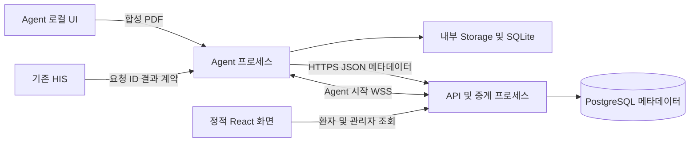

# v2.3 아키텍처

React·PDF.js와 기존 다크 Agent·관리자·환자 화면을 유지한다. 로컬에서는 웹·중계와 Agent가 별도 Node 프로세스다. 웹 Agent UI는 루프백 Agent API로 등록 요청을 직접 전달한다. TLS 포트에는 Agent의 HTTPS 등록과 WSS 연결만 허용하며 환자·관리자 웹은 테스트 HTTP 루프백이다.

Agent는 파일 확인 후 요청 ID를 SQLite에 먼저 기록한다. PDF를 내부 임시 파일에 기록·동기화한 뒤 날짜/UUID 경로로 원자적으로 이름을 바꾼다. HTTPS로 해시와 메타데이터를 등록하면 서버가 등록 시각과 기한을 확정한다. Agent가 정책 스냅샷을 저장하고 활성화를 확인한 뒤 READY를 반환한다. 응답 유실 또는 재시작 시 동일 ID로 회복한다. 수정본은 신규 ID다. 재시작 시 인덱스의 파일 경로·크기·해시와 고아 사본을 확인한다.

중계는 Agent 연결에서 META 및 순번이 있는 바이너리 CHUNK를 받고, HTTP 응답이 청크를 소화한 뒤 ACK로 다음 청크를 수신한다. 동시 요청, 청크, 첫 응답 및 전체 시간에 상한을 둔다. Agent가 꺼지면 연결 불가를 표시한다.

Netlify는 이후 정적 웹 제공 후보로만 검토한다. PDF 요청은 별도 중계 API로 직접 연결한다. 환자 화면과 API를 분리할 때는 허용 origin, 쿠키, CSRF, CDN 캐시 제외를 별도로 검증한다. Windows Service, 폴더 감시 및 Oracle은 후속 단계다.
## 3단계 인증 경로

Agent는 무작위 토큰을 SQLite에 AES-256-GCM으로 기록한 뒤 문서별 salt 및 HMAC 검증값과 토큰 해시를 HTTPS로 등록한다. READY 재조회 시 Agent는 중앙의 활성 토큰 해시와 로컬 복호화 결과를 대조한다. 중계는 인증된 문서의 PDF만 WSS로 요청하며 서명된 FETCH에 조회·다운로드·관리자 미리보기 용도를 포함한다.

관리자의 링크 확인과 재발급은 2분 유효한 문서·세대·용도 지정 서명 증표를 발급한 뒤 루프백 Agent가 수행한다. Agent는 신규 토큰을 암호화 저장한 뒤 해시만 등록한다. 화면과 환자 API는 기본적으로 동일 루프백 HTTPS origin이다. 별도 Agent UI 호출은 정확한 origin을 검사한다.
