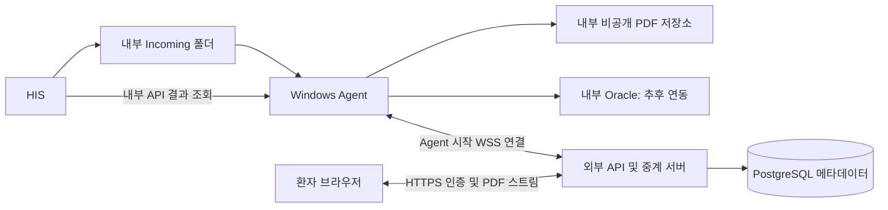

# PGS v2.3 — 2단계 개발 지시서

- 작성일: 2026-11-24
- 기준: PGS_REQUIREMENTS_v2.1.md, PGS_CODEX_PHASE_0_1_v2.1.md 및 기존 구현
- 본 문서는 저장소, 조회 아키텍처 및 보관 정책에 관한 우선 적용 변경 명세이다. 충돌하는 v2.1 및 v2.2 요구사항은 본 문서로 대체하고 나머지는 유지한다.
- 이번 범위: PostgreSQL 메타데이터, 내부 PDF 저장소, 로컬 중계 통신 PoC, 수동 등록 및 통합 검증. 실제 환자정보·운영 Oracle·외부 배포 금지.

## 1. 확정 정책

| 항목 | v2.3 기준 |
|---|---|
| PDF 원본 | 병원 내부 Windows Agent PC에만 영구 저장 |
| 외부 서버 | PDF 디스크/DB/Object Storage 저장 금지; 인증된 요청에 한해 일시적 메모리 스트리밍 |
| PostgreSQL | 외부 메타데이터 DB 유지 검토, 이번에는 로컬 테스트 DB |
| 통신 | Agent가 시작하는 outbound WSS/HTTPS 443, 외부에서 내부 PC로 직접 접속 금지 |
| 환자 인증 | 고유 링크 + 생년월일 8자리, 운영 적정성 별도 승인 |
| 보관 및 링크 | 최초 등록 성공부터 기본 30일(720시간), 관리자 설정 1~90일, 링크는 보관기간 이내, 재발급으로 보관 연장 불가 |
| 문서 수정 | 기존 문서와 신규 문서 각각 독립 ID 및 만료일 유지 |
| HIS | 내부 Agent API로 READY 및 URL 조회, 등록 성공 후 기존 알림톡 시스템이 발송 |
| 파일명 | 0100111120261124a01.pdf (7자리 환자번호, 8자리 날짜, 3자리 식별코드 가정; 설정 가능) |
| 규모 | 일 1,000건 × 85KB × 30일 = 2.55GB, 여유 30% 포함 3.315GB; 90일 7.65GB, 여유 포함 9.945GB. 내부 여유공간 20GB 권장; 대기열/로그/백업 별도. 외부 DB 문서당 2KB 가정 시 30일 약 60MB, 90일 약 180MB(기타 로그/백업 별도) |
| 조회 통계 | 제외, 필수 보안 및 운영 로그만 최소 수집 |

## 2. 목표 구조



Netlify는 정적 프론트엔드 후보로 유지한다. 장시간 연결과 스트리밍을 담당하는 중계 서버는 별도 상시 실행 Node.js 서비스로 구성한다. Netlify Functions가 지속 연결을 지원한다고 가정하지 않는다. 운영에서는 승인된 국내외 호스팅 및 네트워크 정책을 확인한다. 가능하면 환자 웹과 API를 동일 origin으로 제공하고, 분리 시 정확한 origin 허용 목록과 쿠키/CSRF 정책을 검증한다. 일반 역방향 터널로 내부 파일 서버 전체를 노출하지 않는다.

## 3. 2단계 작업 범위

1. 기존 소스, 0~1단계 테스트, 화면 및 API 계약을 분석하고 변경 영향도를 기록한다. 기존 UI 및 기술 스택을 유지하고 불필요한 재작성 금지.
2. 외부 PDF 업로드 및 Object Storage 구현/Mock을 내부 저장소 어댑터로 교체한다. 외부 파일 업로드 경로는 제거 또는 명시적으로 비활성화한다.
3. 로컬 PostgreSQL 마이그레이션과 Agent 영속 로컬 인덱스(SQLite 권장)를 구현한다.
4. Agent 수동 등록, 파일 검증, 원자적 저장, 메타데이터 등록, READY 반환을 구현한다.
5. Agent 시작형 WSS 중계 PoC와 제한된 테스트 문서 조회/다운로드를 구현한다. 운영 환자 인증은 3단계이며 테스트 인증은 로컬 전용으로 격리한다.
6. 만료 시 접근 차단과 삭제 작업의 기본 인터페이스 및 테스트를 구현한다. 자동 감시/실제 Oracle은 4단계, HIS 운영 연동은 5단계, 운영 삭제 스케줄러는 6단계.

## 4. 내부 저장소 및 등록

```text
D:\PatientGuide\
  Incoming\
  Storage\YYYY\MM\DD\<documentId>.pdf
  Processing\
  Failed\
  Data\agent.sqlite
  Logs\
```

- 경로는 설정 가능. Storage는 IIS 공개 경로 및 공유 웹 폴더 밖에 두고 서비스 계정만 읽기/쓰기 허용. BitLocker 등 저장 암호화 운영 전 적용. 실제 환자 파일을 Git, 테스트 fixtures, 클라우드 동기화 폴더에 넣지 않는다.
- 파일명 파서 기본 정규식 `^(\d{8})(\d{8})([A-Za-z]\d{2})\.pdf$` (대소문자 정책 명시). 실제 날짜 검증, 환자번호 문자열 유지. 코드 의미는 OPEN_ISSUES.md에 기록.
- 수동 등록: 파일 선택 → 안정된 파일 확인 → PDF 시그니처/파서 및 크기 검사(초기 상한 10MB 설정 가능) → Mock 환자정보 확인 → UUID 생성 → 내부 임시 파일 기록 및 SHA-256 → 원자적 rename → 로컬 인덱스 커밋 → 외부 메타데이터 등록 → READY.
- 원본 파일과 환자 매칭은 신뢰된 HIS 생성 규칙에 의존한다. 불일치/미확인 환자는 등록 차단. 실제 Oracle은 이번 단계 연결 금지.
- 원본 Incoming 및 Processing, Failed 등 중복 사본의 보관/정리 책임을 명확히 한다. 원본 HIS 소유 파일은 승인 없이 삭제하지 않는다. Agent 관리 사본은 문서별 확정 보관기간 적용. 등록 실패/미등록 임시 사본은 생성 시각 기준 별도 정리 기한(기본 30일 이내)을 두어 무기한 보관 금지.
- 파일 읽기는 documentId로 로컬 인덱스에서만 매핑한다. 외부 요청의 경로/파일명/URL을 직접 파일 열기에 사용 금지. canonical path, root containment, symlink/reparse point 검증, 경로 순회 방지.
- 요청 ID를 등록 전에 영속화하고 재시도 시 재사용. 동일 요청+동일 해시/메타데이터는 동일 결과, 동일 요청+상이한 내용은 409. 수정본은 새 요청 ID. 장애 복구 시 미완료 레코드 및 고아 파일 정합성 검사.

## 5. DB 변경

외부 PostgreSQL에는 PDF bytea, base64, 원본 파일명, 내부 경로, 환자명, 환자번호 원문, 생년월일 원문을 저장하지 않는다. 기존 스키마를 조사하고 마이그레이션으로 변경하며 운영 데이터 삭제나 파괴적 초기화는 금지한다.

| 테이블 | 핵심 필드/변경 |
|---|---|
| pgs_agent | agent_id UUID PK, client_id, status, last_seen_at, enabled |
| pgs_document | document_id UUID PK, agent_id FK, client_id, request_id, patient_key(필요 시 HMAC), birth_verify(3단계용 nullable), key_version, doc_type, doc_title(개인정보 없는 명칭), file_size, file_hash, registered_at, expires_at, delete_at, status, deleted_at |
| pgs_access_token | 기존 구조 유지, token_hash unique, 문서별 만료/차단 |
| pgs_session | 기존 구조 유지, 문서 및 토큰 범위 제한 |
| pgs_transfer_log / pgs_delete_log / pgs_security_log | 기존 유지, 민감정보 및 본문 금지 |

- storage_key는 제거 또는 마이그레이션 호환용 deprecated 처리. 실제 내부 경로를 넣지 않는다.
- UNIQUE(client_id, request_id), INDEX(agent_id,status), INDEX(status,delete_at), FK 및 상태 제약. 시간은 timestamptz, UTC 기준 저장, 화면 KST.
- Agent SQLite: document_id, request_id, local_path, original_filename, hash, size, state, registered_at, expires_at, retry_count, last_error_code. 필요 최소 개인정보만 보호된 저장소에 보관. URL 재조회 필요 시 토큰 원문은 암호화 저장 및 접근 제한, 로그 금지. 외부 DB는 토큰 해시만 보관하고 재시도 응답 복구가 필요하면 별도 암호화된 발급 결과를 제한적으로 보관하거나 Agent가 생성한 동일 토큰을 안전하게 재사용하는 계약을 설계한다.
- 상태: LOCAL_SAVED → REGISTERING → READY → EXPIRED/REVOKED → DELETING → DELETED; 실패는 RETRY_PENDING/FAILED/DELETE_FAILED. READY는 내부 파일과 메타데이터 모두 확정된 경우만. Agent 연결 상태는 별도 표시.

## 6. API 및 중계 계약

기존 multipart PDF 업로드 계약을 메타데이터 전용으로 변경한다. 기존 UI 호출부와 문서를 함께 수정한다.

| API | 역할 |
|---|---|
| POST /api/v1/documents | Agent 인증 후 JSON 메타데이터 등록, documentId/만료 반환, 운영 URL 발급은 3단계 |
| GET /api/v1/requests/:requestId | 권한 범위 내 등록 상태 및 결과 확인 |
| WSS /api/v1/agent/connect | Agent 인증, heartbeat, 요청/응답 프레임 |
| GET /api/v1/patient/pdf | 문서별 인증 세션 확인 후 중계 스트림 |
| GET /api/v1/patient/download | 동일 검증 후 attachment 스트림 |
| GET /internal/v1/requests/:requestId | 내부 HIS용 상태 조회, 운영 계약은 5단계 |

등록 예시(JSON, 가상 데이터):

```json
{"requestId":"TEST-001","documentId":"550e8400-e29b-41d4-a716-446655440000","agentId":"550e8400-e29b-41d4-a716-446655440001","documentCode":"a01","fileSize":85000,"fileHash":"<sha256>","createdAt":"2026-11-24T05:30:00Z"}
```

- agentId는 인증된 연결의 ID와 일치해야 한다. 클라이언트별 문서 접근권한 검증. 서버가 등록시각과 승인된 보관 정책을 기준으로 만료 및 삭제 시각을 결정하고 Agent가 이를 영속화한다. 등록 재시도는 최초 확정 시각 및 정책을 유지한다.
- 중계 프레임: HELLO, HEARTBEAT, FETCH(requestId,documentId,deadline,권한증표), META(size,contentType), CHUNK(sequence,binary), END, ERROR, CANCEL. 요청별 correlation ID, 순서/크기 검증, bounded buffer 및 backpressure, 동시 요청 격리. 인증된 Agent 연결에만 요청 전달. Agent는 권한증표의 서명·대상·만료·재사용 여부 및 로컬 문서 상태를 검증한다. 임의 명령 실행 기능 금지.
- 초기 설정 예시: heartbeat 15초, offline 45초, 첫 응답 10초, 전체 30초, 동시 10건/Agent, 최대 PDF 10MB. 설정 가능, 재연결 exponential backoff+jitter. 연결 끊김/환자 취소 시 파일 핸들 및 버퍼 정리.
- PDF.js는 초기 전체 파일 스트리밍(200, Content-Length) 방식으로 구현 가능. Range를 지원하지 않으면 명시적으로 비활성화하고 206을 가장하지 않는다. PDF 원문은 로그, 디스크, DB, 큐, CDN, 오류 추적에 기록하지 않는다. 프록시 임시 파일 및 응답 캐시도 비활성화 검증.
- 오류: 401/403 인증·권한, 404 문서 없음, 409 중복 충돌, 410 만료/차단, 503 Agent 오프라인, 504 응답 지연. 환자에게 내부 경로/호스트/상세 예외를 노출하지 않는다. 전송 중 실패 시 부분 응답 종료, UI 재시도 안내.

## 7. 보안 및 운영 제약

- 로컬 PoC는 loopback 바인딩 및 테스트 인증만 사용. 운영 환경에서 Mock 인증이 켜지면 시작 실패하도록 구성. 운영 환자 URL 발급·생년월일 검증·세션은 3단계에서 실제 구현.
- 운영은 TLS 검증 필수, Agent별 인증서(mTLS 가능 시) 또는 회전 가능한 제한된 자격증명, 서버 및 Agent 상호 인증, 비밀값 OS 보호 저장소/환경변수. 방화벽 outbound 허용 목록, 인바운드 공개 금지.
- 생년월일은 내부 Oracle에서 추후 조회. 외부 저장 시 문서별 salt/context 및 서버 비밀키 기반 HMAC 검증값만 사용하고 원문 로깅 금지. 생년월일만으로 강한 본인 인증이 되지 않으므로 운영 승인 및 추가 인증 검토.
- 운영 링크는 256비트 무작위 토큰, 세션 문서별 제한, 실패 횟수 제한, 재검증. 토큰을 access log/referrer에 노출하지 않는다. 모든 조회·다운로드에서 만료/차단 확인. no-store, Referrer-Policy: no-referrer, 검색 차단, 서비스워커 캐시 금지. 다운로드된 환자 사본은 회수 불가.
- 외부 중계는 PDF를 영구 저장하지 않지만 일시적으로 평문 처리할 수 있다. 위탁처리/서버 소재지/메모리 덤프/스왑/프록시 로그 및 보안 승인 필요. 실제 환자정보로 테스트하지 않는다.
- Agent PC 종료/절전/네트워크 장애 시 조회 불가. 운영 전 상시 가동 서버급 PC, UPS, 자동 서비스 재시작, 디스크 장애 및 복구 정책 검토. 오프라인 시 외부 파일 사본으로 우회하지 않는다.

## 8. 기본 30일 보관 및 삭제 정책

등록 성공 시각 + link_validity_days × 24시간에 접근 즉시 차단. PDF 삭제 기한은 등록 성공 시각 + retention_days × 24시간이며 기본값은 모두 30일(720시간)이다. 링크가 먼저 만료되어도 PDF는 확정된 삭제 기한까지만 보관한다. Agent도 로컬 만료 검증을 수행하고 외부 연결 여부와 무관하게 삭제 가능해야 한다. 2단계에서는 테스트 시계와 수동 실행 가능한 삭제 작업을 구현하고 6단계에서 10분 주기 운영 스케줄러 및 재시도/경보 완성. 삭제 전 상태 전환으로 신규 읽기 차단, 진행 중 스트림 종료 정책 적용, 파일 핸들 정리 후 삭제. 삭제 확인 후 외부 메타데이터의 인증값·토큰·세션·불필요 식별값 제거, 최소 삭제 기록만 정책에 따라 유지. 오프라인 삭제 결과는 재연결 시 동기화. 백업/임시 파일도 보관 정책에 포함.

### 8.1 환경설정 및 문서별 정책 확정

- 기본 설정 `retention_days=30`, `link_validity_days=30`, `max_retention_days=90`, `delete_interval_minutes=10`. 기간은 정수 1~90일이며 링크 기간은 PDF 보관기간 이하로 제한한다. 최대 90일은 코드/DB/API에서 강제하고 운영 승인을 받은 관리자만 변경 가능하다.
- 정책 우선순위: 승인된 안내문 종류별 설정 → 시스템 기본값. 신규 등록 시 서버에서 정책을 확정하고 문서별 `retention_days`, `link_validity_days`, `policy_version`, `registered_at`, `expires_at`, `delete_at`을 PostgreSQL 및 Agent SQLite에 영속화한다. 기존 등록 문서에는 설정 변경을 소급하지 않는다. 기존 7일 문서의 기한도 자동 연장하지 않는다.
- PostgreSQL 및 SQLite 마이그레이션에서 신규 기본값을 30일로 변경하고 기존 확정 만료일을 보존한다. `expires_at <= delete_at` 및 기간 범위 제약을 적용한다. UTC 기준으로 정확한 경과시간을 계산하고 KST로 표시한다.
- 재발급은 기존 delete_at을 넘을 수 없으며 이미 만료된 문서는 자동 부활시키지 않는다. 수정본은 신규 등록으로 독립 기한 적용. 정책 변경 이력은 관리자, 변경 전후 값, 시각만 최소 기록한다.
- Agent와 서버의 정책 동기화 실패 시 등록 READY를 반환하지 않는다. 만료된 링크 및 세션은 삭제 작업의 성공 여부와 무관하게 차단한다. Agent 오프라인 시에도 로컬 삭제 기한 준수, 재연결 시 외부 메타데이터 정리. 링크 만료 시 토큰/세션 및 불필요한 인증값 정리, 파일 삭제 시 남은 불필요한 식별정보 정리.
- Netlify는 정적 웹 제공 전용 후보로 유지하고 PDF 요청은 별도 중계 API로 직접 전달한다. Netlify 프록시를 통한 PDF 전송은 사용하지 않는다. 월 30,000건, 문서당 평균 2회 전체 전송 시 중계 서버 PDF 송신량 약 5.1GB/월(추가 웹/API/프로토콜 트래픽 제외). 보관기간 자체가 전송량을 결정하지 않는다.

## 9. 화면 변경

- Agent: 기존 모던 다크 유지. 내부 저장 경로, 저장 성공/메타등록/READY 상태, 중계 연결 상태, 최근 heartbeat, 보관 건수/용량, 기본 30일 정책 및 문서별 만료일, 저장소 80% 경고, 실패 재시도, 수동 등록 및 로컬 미리보기 표시.
- 관리자: 보관기간/링크 유효기간 기본값 및 안내문 종류별 설정, 최대 90일 제한, 신규 문서 적용 안내, 정책 변경 이력 표시. 외부 업로드 버튼 제거 또는 내부 Agent에서 등록하도록 안내. Agent 상태, 문서 등록/만료/삭제 상태, 조회 가능 여부 표시. 관리자 미리보기도 권한 검증된 중계만 사용.
- 환자 웹: 기존 UI 유지. 로컬 테스트 인증 후 PDF 조회/다운로드, Agent 오프라인 및 시간초과 안내. 실제 운영 인증 완료 전 외부 공개 금지.

## 10. 검수 및 완료 기준

- [ ] 기존 0~1단계 UI/Mock 회귀 테스트 통과.
- [ ] PostgreSQL 로컬 마이그레이션/재실행 성공, 실제 PDF 및 내부 경로가 외부 DB에 없음.
- [ ] 수동 등록 후 내부 Storage에 UUID 파일 생성, 해시 일치, 메타데이터만 외부 API로 전달.
- [ ] 동일 요청 재시도/응답 유실/Agent 재시작 시 중복 없음; 수정본은 독립 문서.
- [ ] 파일명 오류, 날짜 오류, 미확인 환자, 비PDF, 과대 파일, 경로 순회 및 symlink 차단.
- [ ] Agent 시작 WSS 연결로만 PDF 조회/다운로드 성공, 원본과 SHA-256 일치.
- [ ] 다른 Agent/문서 요청, 위조/만료/재사용 권한증표 및 미인증 요청 차단.
- [ ] 오프라인/재연결/시간초과/취소/동시 요청 시 다른 환자 파일 혼입 없음, 버퍼 정리.
- [ ] 외부 서버 디스크/DB/로그/프록시 캐시에 PDF 및 민감정보 미잔류 확인.
- [ ] 기본 720시간 경계 및 강제 차단 검증, 삭제 실패 재시도 및 오프라인 삭제 동기화 테스트.
- [ ] 1/30/90일 설정, 범위 초과 및 링크 기간 초과 차단, 종류별 정책, 기존 7일 문서 기한 유지, 신규 문서 30일 적용, 재발급 및 수정본 독립 기한 검증.
- [ ] 30,000건 메타데이터 가상 적재 및 DB/인덱스 용량 측정, 내부 저장소 용량 경고 검증.
- [ ] 1,000건 가상 등록 및 동시 10건 조회 테스트 결과(응답시간/메모리/오류율) 기록.
- [ ] 운영 모드 Mock 인증 차단, 실제 Oracle/알림톡/외부 배포 미실행.

## 11. 산출물 및 실행 안내

기존 프로젝트에 migration, 내부 저장소 어댑터, SQLite 인덱스, WSS 중계 모듈, 로컬 Docker Compose, 가상 PDF fixtures, 자동화 테스트를 추가한다. README에 Windows 실행 순서, PostgreSQL 초기화, Agent/API/웹 실행 주소, 수동 등록 및 중계 테스트 방법을 기록한다. ARCHITECTURE.md, DATABASE.md, API_SPEC.md, SECURITY.md, TEST_PLAN.md 및 기존 요구사항 문서의 충돌 항목(7일/168시간 기본값, 외부 PDF 저장)을 갱신하고 CHANGELOG.md에 v2.3 변경사항을 기록한다. OPEN_ISSUES.md에는 파일명 규칙, Oracle 조회 SQL, 네트워크 허용 정책, 호스팅, 인증 승인, 로컬 원본 삭제 책임을 남긴다.

작업 완료 후 변경 파일, DB 마이그레이션 결과, 실행 명령, 화면 캡처, 테스트 실제 결과(미실행은 명시), 미해결 문제, 3단계 착수 조건을 보고한다. 2단계 검증 후 종료하며 3단계 운영 인증, 4단계 자동 감시/Oracle, 5단계 HIS 연동, 6단계 운영 삭제, 7단계 통합 보안, 8단계 배포는 추가 요청 전 진행하지 않는다.
