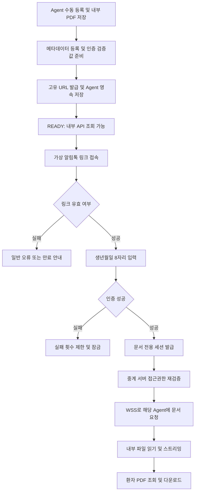

# PGS v2.3 — 3단계 상세 개발 지시서

작성일: 2026-11-25

## 1. 목적 및 우선 적용 기준

PGS_REQUIREMENTS_v2.1.md, PGS_CODEX_PHASE_0_1_v2.1.md, PGS_CODEX_PHASE_2_v2.3.md 및 기존 구현을 기준으로 실제 보안 토큰 발급, 생년월일 검증, 문서별 세션, 내부 Agent PDF 실시간 조회·다운로드를 구현한다. 저장 및 보관 정책은 2단계 v2.3을 유지한다. 본 문서는 3단계 인증 및 조회 계약을 구체화한다. 기존 UI/스택을 유지하고 불필요한 재작성 금지. 실제 2단계 완료 여부는 소스 및 테스트로 확인한다.

- PDF 원본은 병원 내부 Agent PC에만 영구 저장. 외부 PostgreSQL은 최소 메타데이터만 관리. 외부 중계 서버는 일시적 메모리 스트리밍만 수행.
- Agent 시작형 outbound WSS/HTTPS 443 유지. 내부 PC 인바운드 공개 금지.
- 기본 보관 및 링크 유효기간 각각 30일(720시간), 승인된 관리자 설정 1~90일, 링크 기간은 보관기간 이하. 기존 확정 만료일 소급 변경 금지. 수정본은 독립 문서.
- 일 1,000건, 평균 85KB. 30일 내부 PDF 약 2.55GB, 외부 DB 약 60MB(문서당 2KB 가정).
- 실제 환자정보, 운영 Oracle, 실제 알림톡, 외부 배포 금지. 가상 환자 데이터와 로컬 PostgreSQL만 사용. 인증 알고리즘은 실제 구현하되 테스트 자격증명만 사용.

## 2. 착수 전 검증

기존 2단계 README, API_SPEC, DATABASE, SECURITY, OPEN_ISSUES 및 소스를 확인한다. 로컬 등록, SQLite 인덱스, PostgreSQL 마이그레이션, WSS 연결, 파일 해시 일치, 오프라인 처리, 만료 정책, 외부 미저장 테스트를 재실행한다. 실패하면 원인을 기록하고 필요한 선행 결함만 수정한다. 실제 결과 없이 완료로 표시하지 않는다. 기존 테스트 인증 경로는 운영 환자 경로에서 제거하고 테스트 전용으로 격리한다.

## 3. 전체 업무 흐름

## 4. URL 발급 및 등록 정합성

- 문서당 32바이트 CSPRNG 난수, base64url 인코딩. URL에 환자번호/이름/생년월일/파일경로 금지. 예시 `https://guide.example.invalid/g/<token>` (가상 주소).
- 외부 DB에는 SHA-256 토큰 해시만 저장하고 unique 제약 적용. 토큰 원문은 Agent 보호 저장소에 암호화 저장하여 HIS 재조회에 대비한다. Agent가 토큰을 생성·영속화한 뒤 해시를 등록하는 계약을 권장한다. 기존 구현이 서버 생성 방식이면 암호화된 발급 결과 복구 방식으로 동등한 재시도 보장; 선택 및 이유 기록. 등록 API는 원문 토큰을 로그에 남기지 않는다.
- 동일 client_id/request_id 재시도는 동일 문서 및 동일 URL 반환, 내용 충돌은 409. 등록 응답 유실 및 Agent 재시작 시 중복 발급 금지. 내부 저장, 인증값 준비, 정책 확정, 토큰 활성화 및 Agent URL 영속화 완료 후에만 HIS용 READY 표시. 오프라인 여부는 별도 표시.
- 링크 만료는 최초 등록 성공 시각 기준 확정된 expires_at 이하. 재발급은 이전 토큰과 해당 세션을 폐기하고 기존 만료일을 유지한다. 만료/삭제/폐기 문서 부활 금지. 수정 문서 신규 등록은 기존 링크에 영향 없음.
- 토큰 포함 경로는 프록시/서버/오류추적 로그에서 마스킹. 링크 미리보기 GET/HEAD는 인증 시도 횟수를 증가시키거나 토큰을 소모하지 않는다. 토큰이 브라우저 기록에 남을 수 있으므로 인증 이후 가능하면 토큰 없는 화면으로 이동하고 Referrer-Policy no-referrer 적용.

## 5. 생년월일 인증

- 입력 YYYYMMDD 8자리 문자열, 실제 달력 날짜 검증, 숫자 이외 입력 차단. 가상 환자 조회 어댑터로 검증값 생성. 4단계에서 Oracle 어댑터 교체 예정.
- 외부 DB에는 생년월일 원문, 환자명/환자번호 원문 금지. 문서별 context/salt와 서버 비밀키 기반 HMAC-SHA256 검증값 및 key_version만 저장. 예: HMAC(key, canonicalEncode('pgs-birth-v1', documentId, salt, birthDate)). 키는 DB와 분리하고 상수시간 비교. Agent 등록 시 필요한 생년월일 전달은 인증된 TLS 요청에서 일시 처리 후 폐기; body logging 금지. 키 회전 시 기존 유효 문서 검증 가능하도록 버전 관리. 단순 SHA-256 생년월일 해시 금지.
- 유효 토큰 및 문서 상태 확인 후 검증. 실패 응답은 환자 존재 여부나 생년월일 일치 여부 외 상세 정보 노출 금지. 기본 5회 실패 시 30분 잠금. DB 원자적 카운터로 동시 요청 우회 방지. 토큰별 및 IP별 속도 제한, 전체 서비스 제한 적용. 성공 시 실패 카운터 초기화, 잠금 만료 후 재시도 가능. IP만으로 영구 차단 금지. 잠금 중 재시도는 잠금 무한 연장하지 않는다.
- 생년월일은 추측 가능한 정보이므로 강한 본인확인 수단이 아니다. 운영 전 병원 승인 및 추가 인증 필요성 검토를 OPEN_ISSUES에 남긴다.

## 6. 세션 및 권한

- 인증 성공 시 256비트 불투명 세션 난수 발급, DB에는 해시만 저장. document_id, token_id, expires_at, revoked_at 연결. 기본 절대 만료 15분, 문서/링크 만료보다 늦을 수 없음. 자동 무한 연장 금지.
- 가능하면 동일 origin HTTPS 및 Secure, HttpOnly, SameSite 쿠키 사용. Netlify 분리 시 승인된 정확한 origin만 CORS 허용하고 credentials/CSRF 정책 검증. 서로 다른 사이트의 쿠키 제한을 고려하여 운영 도메인 구조를 결정. 로컬 HTTP 예외는 loopback 테스트 전용. 토큰/세션 localStorage 저장 금지.
- 모든 PDF 조회, 다운로드, Range 요청에서 세션·토큰·문서 상태 및 만료 재검증. 클라이언트 제공 documentId를 권한 근거로 사용하지 않는다. 다른 문서/Agent 접근 차단. 로그아웃, 재발급, 폐기, 만료 시 세션 무효화. 전송 중 만료/폐기 시 스트림 중단 및 핸들 정리.

## 7. API 계약 (기존 경로 우선, 변경 시 문서 갱신)

| Method / Path | 역할 |
|---|---|
| POST /api/v1/documents | Agent 인증, 메타데이터 및 검증값 준비, 토큰 해시 등록; PDF 업로드 금지 |
| GET /api/v1/requests/:requestId | Agent 권한 범위 내 등록 상태 조회 |
| POST /api/v1/patient/verify | token, birthDate 검증 및 세션 발급 |
| GET /api/v1/patient/session | 인증된 문서의 최소 표시정보 및 만료시각 |
| GET /api/v1/patient/pdf | 인증 세션 기반 inline PDF 스트림 |
| GET /api/v1/patient/download | 동일 권한 검증 후 attachment 스트림 |
| POST /api/v1/patient/logout | 세션 폐기 |
| POST /api/v1/documents/:id/reissue | 권한 있는 관리자/Agent의 재발급 절차 |
| POST /api/v1/documents/:id/revoke | 문서 접근 차단 및 세션 폐기 |
| GET /internal/v1/requests/:requestId | 내부 Agent의 READY 및 URL 반환, HIS 실제 연동은 5단계 |

검증 요청 예시: `{ "token": "<synthetic-token>", "birthDate": "19800101" }`. 성공 응답에는 개인정보 없는 문서명, expiresAt, sessionExpiresAt만 반환하고 세션 쿠키 설정. 실패는 401 인증 실패, 403 권한 없음, 410 만료/폐기, 429 잠금/제한, 503 Agent 오프라인, 504 중계 지연. 유효하지 않은 링크는 일반화된 오류 응답. 내부 예외/경로/SQL 노출 금지. 변경 API에 OpenAPI 또는 기존 명세 및 테스트 추가.

## 8. DB 및 마이그레이션

기존 스키마 조사 후 비파괴 마이그레이션. 아래는 논리 필드이며 중복 테이블 생성 금지.

- pgs_document: document_id, agent_id, client_id, request_id, birth_verify, birth_salt, key_version, status, registered_at, expires_at, delete_at, policy_version. UTC timestamptz, 화면 KST. expires_at <= delete_at 강제.
- pgs_access_token: token_id, document_id FK, token_hash UNIQUE, issued_at, expires_at, revoked_at, failed_count, locked_until. 문서별 활성 토큰 하나를 트랜잭션/제약으로 보장.
- pgs_session: session_hash UNIQUE, token_id FK, document_id FK, created_at, expires_at, revoked_at. 문서/토큰 일치 검증 및 만료 인덱스.
- pgs_security_log: 이벤트 종류, 시간, 최소 가명 식별자, 결과 코드. 원문 토큰/생년월일/PDF/세션/내부 경로 금지. 환자 열람 통계 및 성공 열람 이력 수집 제외. 보안 로그 보존기간은 승인 정책으로 설정.
- Agent SQLite: 등록 요청과 암호화 URL, 문서 ID, 로컬 경로, 확정 만료일, 상태. 외부 DB에 로컬 경로 저장 금지. OS 보호 키 저장소 사용 권장. 마이그레이션 재실행 및 기존 7일 문서 기한 유지 검증.

## 9. PDF 중계 및 브라우저

- 2단계 WSS FETCH/META/CHUNK/END/ERROR/CANCEL 계약 재사용. 서버가 세션 검증 후 짧은 유효기간의 서명된 요청 증표 발급; agentId/documentId/requestId/deadline 및 용도 바인딩, 재사용 차단. Agent는 로컬 인덱스 및 만료 상태 검증 후 지정 파일만 읽는다.
- bounded buffer, backpressure, 요청별 격리, 취소/연결 종료 처리. 기본 첫 응답 10초, 전체 30초, 동시 10건/Agent, 최대 10MB는 기존 설정 유지. 실제 테스트로 적정성 확인.
- Content-Type application/pdf, Content-Disposition inline 또는 attachment, 개인정보 없는 안전한 파일명, Cache-Control no-store, X-Content-Type-Options nosniff, Referrer-Policy no-referrer. CDN/프록시 캐시 및 임시 파일, 서비스워커 캐시 금지. PDF.js는 전체 파일 조회부터 구현; Range 미지원 시 비활성화, 가짜 206 금지. PDF.js 스크립트 실행 제한 및 안전한 최신 승인 버전 사용.
- 외부 서버 디스크/DB/큐/로그/오류 추적에 PDF 또는 base64 저장 금지. 프록시 버퍼 디스크 스풀, 스왑, 덤프 등 운영 환경 확인 필요. 브라우저 다운로드 사본은 서버에서 회수 불가.
- Netlify는 정적 웹 후보, PDF 요청은 별도 상시 중계 서버 직접 호출. 로컬에서는 동일 origin 프록시 사용 가능. 실제 배포 및 외부 네트워크 연결 금지.

## 10. 화면 요구사항

### 환자 모바일
- 기존 밝은 UI 유지. 문서별 링크 접속, 생년월일 숫자 키패드(inputmode numeric), 8자리 안내, 큰 버튼, 오류 접근성, 로딩 중 중복 제출 방지.
- 인증 후 해당 문서만 표시. PDF 확대/축소, 페이지 이동, 전체 페이지 표시, 다운로드, 종료. 모바일 가로 스크롤 최소화. 세션 만료 시 재인증 안내 및 화면 PDF 버퍼/Blob URL 정리.
- 만료/잠금/오프라인/파일 없음/시간초과/전송 중단 화면. 내부 정보 미노출. 오프라인 시 외부 PDF 사본으로 우회 금지.
- 카카오 인앱 브라우저 및 Android/iOS 실기기 테스트는 가능한 범위에서 수행하고 미실행은 기록. 로컬 테스트를 위해 실제 외부 공개 금지.

### Agent 및 관리자
- 기존 모던 다크 Agent 및 밝은 관리자 UI 유지. 등록 상태, URL 발급 여부, 링크 만료일, 연결 상태, 실패 및 재시도 표시. URL 복사는 권한 있는 사용자만 가능하며 기본 마스킹. 환자 생년월일 원문 표시 금지.
- 관리자 문서 검색, 링크 폐기/재발급, 설정(기본 30일, 최대 90일, 인증 5회/30분 잠금/15분 세션), 변경 이력. 운영 관리자 인증/RBAC가 미완성이면 로컬 테스트 전용으로 제한하고 배포 금지. 환자 열람 통계 제외.

## 11. 검증 체크리스트

- [ ] 2단계 회귀 테스트 및 비파괴 마이그레이션 성공.
- [ ] 가상 PDF 등록 후 고유 URL 발급, 재시도/응답 유실/재시작에도 동일 URL 및 문서 유지.
- [ ] 정상 생년월일 인증 및 PDF 조회·다운로드, 원본 SHA-256 일치.
- [ ] 잘못된 생년월일, 잘못된 날짜, 토큰 위조/누락, 다른 문서 및 다른 Agent 접근 차단.
- [ ] 동시 인증 실패 5회 제한, 30분 잠금 및 해제, IP 속도 제한.
- [ ] 세션 없이 PDF 직접 접근 차단, 15분 경계 및 로그아웃 후 접근 차단.
- [ ] 720시간 만료 경계, 1~90일 설정, 기존 만료일 유지, 링크 재발급/폐기 후 기존 세션 차단.
- [ ] 수정본 신규 등록 시 두 문서 독립 조회 및 만료.
- [ ] Agent 오프라인, 재연결, 시간초과, 취소, 중간 전송 실패, 동시 10건 요청 시 혼입 없음.
- [ ] 외부 DB/디스크/로그/캐시에 PDF 및 원문 민감정보 미잔류, 토큰 로그 마스킹.
- [ ] 카카오 링크 미리보기 요청이 인증 시도 또는 토큰 소모를 유발하지 않음.
- [ ] 모바일 화면, 확대/축소, 다운로드 및 오류 안내 검증.
- [ ] 운영 모드 Mock 우회 차단, CORS/CSRF 및 쿠키 검증, 실제 Oracle/알림톡/외부 배포 미실행.

테스트 시계로 만료/잠금 경계를 재현하고 실제 시간 대기 불필요. 테스트 결과에 명령, 성공/실패 건수, 미실행 항목 및 원인 기록.

## 12. 산출물 및 종료 기준

README, ARCHITECTURE.md, DATABASE.md, API_SPEC.md, SECURITY.md, TEST_PLAN.md, CHANGELOG.md, OPEN_ISSUES.md 갱신. 마이그레이션, 토큰/인증/세션 모듈, 환자 웹 및 WSS 연동, 자동화 테스트 추가. 실행 명령, 가상 환자 테스트 방법, URL 발급부터 다운로드까지 화면 캡처, 변경 파일, 테스트 결과, 미해결 사항 보고. 실제 소스 확인 없이 완료로 표시하지 않는다.

4단계 폴더 자동 감시/Oracle 실제 조회, 5단계 HIS 및 알림톡 실제 연계, 6단계 운영 삭제 스케줄러, 7단계 통합 보안/부하, 8단계 외부 배포는 이번 범위 제외. 3단계 검증 후 종료한다. 운영 전 인증 적정성, 외부 중계 개인정보 처리, 도메인/방화벽, 24시간 Agent 가동, 관리자 권한, 실제 파일명 규칙 및 원본 삭제 책임 승인 필요.
