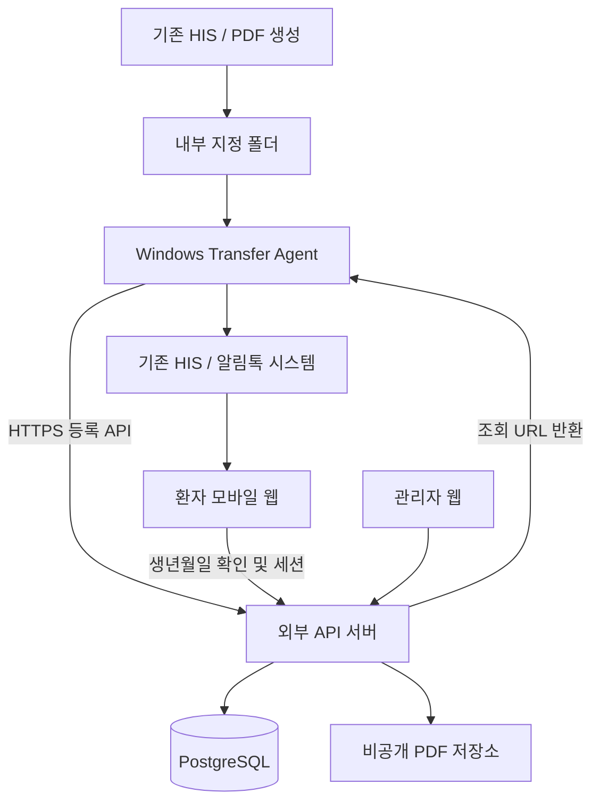

# PGS — 환자 모바일 PDF 안내문 서비스

- 문서 버전: 2.1 / 2026-11-24
- 용도: Codex 개발 지시 및 검수 기준
- 상태: 1·2차 요구사항 통합, 세부 규격 및 운영 보안 승인 대기

변경 이력 v2.1: PDF 보관기간을 7일로 단축하고 실제 조회 가능기간도 7일로 일치시킨다. 등록 성공 시각부터 168시간 기준이며, 재발급으로 보관기간을 연장하지 않는다. 내부 Agent 임시·완료 사본 및 백업도 승인된 7일 삭제 정책을 적용한다(기존 HIS 원본 보존 정책은 별도).

## 1. 개발 목적 및 확정 요구사항

기존 병원 프로그램에서 생성하는 환자별 PDF 안내문을 외부 웹서비스에 등록하고, 별도 알림톡 발송 시스템에 문서별 조회 URL을 반환한다. 환자는 앱 설치 없이 모바일 브라우저에서 생년월일 확인 후 자신의 안내문을 열람하거나 다운로드한다.

| 항목 | 확정 요구사항 |
|---|---|
| PDF 생성 | 기존 프로그램의 지정 폴더 |
| 문서 종류 | 여러 종류의 환자별 안내문 |
| 환자 식별 | 파일명에 포함된 환자번호: 예시 0100111120261124a01.pdf |
| 생년월일 | 내부 Agent에서 Oracle 조회 |
| URL 전달 | 내부 Agent API 조회 |
| 발생 규모 | 일 1,000건, 평균 85KB |
| 개인정보 | 환자명 및 환자번호 포함 |
| 재등록 | 기존 문서와 신규 문서 모두 유지, 각자 독립 만료 |
| 등록 | 자동 감시 및 수동 등록 |
| 링크 | 안내문별 개별 링크 |
| 알림톡 | 등록 성공 직후 기존 시스템에서 자동 발송, 실제 발송은 범위 제외 |
| 인증 | 고유 링크 + 생년월일 확인 |
| 링크 유효기간 | 최초 발급 후 7일 (PDF 보관기간과 동일) |
| PDF 보관 | 등록 후 7일, 자동 삭제 |
| 운영 | 별도 외부 호스팅 서버, Netlify 등 검토 |
| DB | PostgreSQL |
| 환자 기능 | 조회 및 다운로드 |
| 조회이력 | 환자 열람 통계 및 조회이력 기능 제외. 필수 보안·관리 로그는 별도 협의 |

## 2. 아키텍처 및 기술 스택



- Agent: Node.js/TypeScript, Chokidar, Electron 관리 UI, Windows Service 기반 독립 백그라운드 프로세스. 서비스와 UI는 ACL로 보호된 로컬 IPC 사용.
- 서버: Node.js/TypeScript + Express, PostgreSQL, 마이그레이션 도구, S3 호환 비공개 저장소.
- 웹: React/TypeScript, Tailwind CSS, PDF.js. 환자 웹과 API는 동일 출처 권장.
- 배포: Docker Compose 기반 로컬 검증, 운영은 승인된 외부 호스팅 및 관리형 저장소. HTTPS 필수.
- 외부 서버에서 병원 Oracle 직접 접속 금지. 내부 Agent만 승인된 내부 연동 경로 이용.
- 실제 환자 데이터는 보안 승인 전 외부 전송 금지. 개발 및 테스트는 합성 데이터만 사용.

## 3. 내부 Agent 상세 기능

### 3.1 폴더 구조 (예시, 설정 가능)

```text
D:/PatientGuide/
  Incoming/     신규 파일
  Processing/   처리 중
  Completed/    완료 파일 또는 결과 정보
  Failed/       오류 격리
  Duplicate/    중복 확인 대상
  Logs/         개인정보 제거 로그
  Config/       비밀키를 제외한 환경설정
```

### 3.2 파일명 규칙

실제 제공 예시: `0100111120261124a01.pdf`. 잠정 분석: 환자번호 `01001111`(7자리), 생성일 `20261124`(8자리), 접미부 `a01`(3자리). 정규식 `^(\d{8})(\d{8})([A-Za-z]\d{2})\.pdf$`를 초기 설정으로 사용한다. 환자번호 길이 및 접미부 의미(종류/순번)는 운영 전 확인한다. 접미부를 문서 종류로 단정하지 말고 매핑 설정으로 분리한다. 생성일은 실제 달력 날짜인지 검증하고 시각은 파일명에서 추정하지 않는다. 환자번호는 문자열로 유지한다. 규칙 불일치, 환자 매칭 실패, 생년월일 누락은 오류 격리한다. 파일명은 내부에서만 사용하며 외부 저장 키에는 포함하지 않는다.

동일 파일명으로 수정본이 발생할 수 있으므로 파일명만으로 중복을 판단하지 않는다. 파일 생성 이벤트와 영속 요청 ID를 연결하고, 동일 이벤트 재시도는 같은 ID, 신규 발급은 새로운 ID를 사용한다. 동일 이름·다른 해시는 신규 문서로 처리하되 생산 프로그램이 파일을 덮어쓰기 전에 Agent가 안전하게 확보할 수 있는 규약을 협의한다. 동일 내용의 의도적 재발급도 별도 발급 ID로 구분한다.

### 3.3 처리 순서

1. 폴더 감시 및 시작 시 미처리 파일 재검색.
2. 파일 크기 안정화, 생성 완료 및 PDF 유효성 확인. 가능하면 생산 프로그램에서 임시 확장자 사용 후 원자적 이름 변경.
3. 파일명 분석, 신뢰 가능한 내부 환자정보 원천으로 환자번호 및 생년월일 확인. PDF와 환자정보의 일치 보장.
4. 영속 대기열(SQLite 등)에 요청 UUID, 파일 해시, 처리상태 기록. 민감정보는 보호된 저장소에 최소 보관.
5. HTTPS multipart API 호출. 동일 요청 재시도에는 동일 requestId 사용.
6. 성공 응답 URL을 기존 HIS에 전달하고 전달 완료 상태 기록. 발송은 기존 시스템에서 담당.
7. 네트워크/5xx 오류는 지수 백오프 및 최대 5회 재시도(초기 제안). 4xx 입력 오류는 수동 확인. 재시작 후 대기열 복구.
8. 완료/실패/중복 폴더 및 임시파일도 병원 승인 보관정책에 따라 삭제. 파일 원본 삭제 권한은 별도 확인.

### 3.4 생년월일 및 결과 연동

Oracle 조회 방식 확정. PatientProvider 인터페이스에 MockPatientProvider와 OraclePatientProvider를 분리한다. 운영 테이블/컬럼 및 접속 방식은 미확정이며 임의로 생성하지 않는다. SQL 예시(실제 테이블명이 아닌 자리표시자): `SELECT <birth_column> FROM <patient_table> WHERE <patient_no_column> = :patientNo`. 바인드 변수, 읽기 전용 최소권한 계정, 연결/조회 타임아웃을 적용한다. 결과 0건/복수건/유효하지 않은 날짜는 전송 금지. Oracle 장애는 재시도 대기. Node oracledb Thin/Thick 선택은 기존 Oracle 버전 및 클라이언트 호환성 확인 후 확정한다. 접속정보는 Windows 보호 저장소에 보관한다. 외부 서버는 Oracle에 접근하지 않는다.

### 3.5 내부 Agent API 및 알림톡 연계

- `POST /internal/v1/requests`: HIS가 발급 요청 ID와 파일명(경로 금지)을 등록하고 자동 감시 작업과 연결하는 권장 방식. HTTP 202 및 requestId 반환. 실제 HIS 변경 가능 여부 확인. 폴더만 감시하는 방식이라면 Agent가 생성한 요청 ID를 HIS가 안전하게 취득할 별도 규약이 필요하며 파일명 단독 조회로 최신본을 임의 선택하지 않는다.
- `GET /internal/v1/requests/:requestId`: 인증된 HIS가 자신의 요청 결과 조회. PENDING/PROCESSING/RETRY_WAIT는 202, READY는 200과 documentId, viewUrl, expiresAt 반환, FAILED는 오류코드 반환. 존재하지 않거나 권한 없는 요청은 일반화된 오류 반환.
- 예시 응답: `{"requestId":"TEST-001","status":"READY","documentId":"<uuid>","viewUrl":"https://guide.example.com/v/<token>","expiresAt":"2026-12-01T14:30:00+09:00"}`.
- HIS는 초기 2초 간격, 최대 60초(설정값) 조회 후 대기열에서 재조회한다. 시간 초과만으로 신규 등록 또는 발송하지 않는다. READY 확인 후 기존 알림톡 시스템에서 requestId 기준 발송 중복 방지 및 발송 결과 관리. Agent는 직접 발송하지 않는다.
- 내부 API는 기본 loopback, 다른 HIS 서버에서 호출할 경우 승인된 내부 인터페이스에만 바인딩, TLS 및 시스템 인증, 방화벽 허용목록 적용. URL/환자정보 응답 캐시 금지. 영속 대기열의 URL은 암호화 보관 후 만료 시 삭제.
- 수동 등록도 내부 Agent의 Oracle 조회와 동일한 매칭 검증을 거친다. 외부 관리자 화면의 수동 등록은 초기에는 내부 Agent 등록 요청 화면 또는 비활성 기능으로 두고, 검증된 별도 경로 승인 전 직접 환자정보 입력을 허용하지 않는다.

## 4. 화면 설계

| 화면 | 주요 기능 |
|---|---|
| Agent 대시보드 | 감시 상태, 서버 연결, 금일 감지/완료/대기/실패 건수 |
| Agent 전송내역 | 기간, 상태, 문서 종류, 마스킹 환자번호, 오류 및 재시도 |
| Agent 수동등록 | 파일 선택, 환자정보 확인, 미리보기, 등록 결과 URL |
| Agent 환경설정 | 감시경로, 파일명 규칙, API 주소, 재시도, 서비스 상태 |
| 관리자 대시보드 | 등록·보관·만료·삭제 건수 (열람 통계 제외) |
| 안내문 관리 | 기간/종류/환자번호 검색, 상태, 만료일, 미리보기, 차단, 재발급 |
| 관리자 수동등록 | 내부 Agent 등록 요청, 승인된 검증 경로 없이는 직접 업로드 비활성 |
| 안내문 종류 | 코드, 명칭, 사용 여부, 정책 관리 |
| API/삭제 관리 | 연동 클라이언트, 오류, 삭제 실패 재처리 |
| 관리자 설정 | 역할, MFA, 환경설정, 보안 로그 |
| 환자 본인 확인 | 생년월일 8자리, 확인 버튼, 오류/잠금 안내 |
| 환자 PDF 조회 | 제목, 페이지 이동, 확대/축소, 다운로드, 만료일 |
| 환자 오류 화면 | 만료/차단/서비스 장애 안내, 병원 문의 안내 |

Agent는 모던 다크 UI, 관리자 웹은 명료한 업무용 UI, 환자 웹은 밝은 배경과 큰 글자 및 버튼을 사용한다. 모바일 320px 이상 대응, 키보드 접근성, 카카오톡 인앱 브라우저/Android Chrome/iOS Safari 검증. 인증 전에는 환자명, 문서 제목 등 민감정보를 표시하지 않는다. 다운로드 이후 환자 기기에 저장된 파일은 서버에서 회수할 수 없음을 안내한다.

## 5. 데이터베이스 설계

PostgreSQL 물리 테이블명은 소문자 snake_case 사용. 시간은 timestamptz, 서버 UTC 저장 및 KST 표시. UUID PK, FK, NOT NULL, CHECK, UNIQUE 제약 및 마이그레이션 적용.

| 테이블 | 주요 컬럼 |
|---|---|
| pgs_document | document_id UUID PK, client_id UUID FK, request_id varchar(100), patient_key varchar(128), birth_verify varchar(128), key_version int, doc_type varchar(20) FK, doc_title varchar(200), storage_key varchar(500), file_size bigint, file_hash char(64), created_at, registered_at, expires_at, delete_at, status, deleted_at |
| pgs_access_token | token_id UUID PK, document_id UUID FK, token_hash char(64) UNIQUE, issued_at, expires_at, fail_count int, locked_until, revoked_at, status |
| pgs_document_type | doc_type PK, doc_name, valid_days default 7, retention_days default 7, download_yn default true, use_yn, sort_order |
| pgs_api_client | client_id PK, client_name, credential_hash, scopes, enabled, rotated_at |
| pgs_transfer_log | log_id PK, client_id, request_id, event_type, result_code, occurred_at |
| pgs_delete_log | log_id PK, opaque_document_id, result_code, attempt_count, occurred_at |
| pgs_admin_user | admin_id PK, identity_provider_id, role, enabled |
| pgs_system_config | config_key PK, config_value, updated_at |
| pgs_security_log | log_id PK, event_type, actor_key, result_code, occurred_at |
| pgs_session | session_hash PK, document_id FK, token_id FK, expires_at, revoked_at |

- UNIQUE(client_id, request_id). 동일 요청 및 동일 데이터는 중복 등록하지 않음. 동일 요청번호에 다른 파일/메타데이터는 409 반환.
- 인덱스: document(patient_key, registered_at), document(status, delete_at), document(doc_type, registered_at), access_token(document_id), session(expires_at).
- 환자번호는 별도 비밀키 기반 HMAC 식별값, 생년월일은 문서 ID와 결합한 별도 HMAC 검증값. 키는 DB 외부 비밀관리 서비스에 보관. 생년월일 원문 저장 금지.
- 토큰 원문은 기본적으로 저장하지 않는다. 응답 유실 후 동일 URL 재반환이 필요하므로 별도 KMS 암호화된 토큰 복구값을 제한된 권한으로 만료일까지 저장하는 방안을 적용한다. 로그에는 원문 금지. 동일 문서의 보안상 링크 교체 시 이전 토큰 및 세션 폐기. 수정본/신규 발급은 새 document_id와 새 링크를 생성하며 기존 문서와 링크를 유지한다.
- 상태: UPLOADING, ACTIVE, EXPIRED, REVOKED, FAILED, DELETING, DELETE_FAILED, DELETED. 삭제 후 개인정보 및 파일키 제거, 필요한 비식별 처리결과만 승인 기간 유지.

안내문 코드 초기 예시: G001 외래, G002 검사, G003 수술, G004 입원, G005 퇴원, G006 시술, G999 기타. 실제 코드 확정 전 테스트용으로만 사용.

## 6. API 규격

| Method | 경로 | 기능 |
|---|---|---|
| POST | /api/v1/documents | PDF 등록 및 URL 발급 |
| GET | /api/v1/documents/:id | 등록 상태 |
| GET | /api/v1/requests/:requestId | 호출 클라이언트 소유 요청 결과 |
| POST | /api/v1/documents/:id/reissue | 동일 문서 링크 교체(기존 링크 폐기); 수정본은 신규 등록 |
| POST | /api/v1/documents/:id/revoke | 접근 즉시 차단 |
| DELETE | /api/v1/documents/:id | 삭제 요청 |
| POST | /api/v1/patient/verify | 토큰 및 생년월일 확인 |
| GET | /api/v1/patient/pdf | 인증 세션 기반 PDF 열람 |
| GET | /api/v1/patient/download | 인증 세션 기반 다운로드 |
| GET | /api/v1/health | 민감정보 없는 상태 응답 |

### 등록 API

`POST /api/v1/documents` / `Authorization: Bearer <credential>` / `multipart/form-data`

필수: requestId, patientNo, birthDate(YYYYMMDD), documentCode, documentName, createdAt(ISO 8601), file(PDF). 날짜 실재 여부 및 형식 검증. 파일 크기 기본 20MB 제안, 운영 규모 확인 후 확정. 실제 PDF 파싱, 악성 파일 검사, 활성 콘텐츠 제한. 사용자 파일명을 저장 경로로 사용하지 않는다.

성공 응답 예시(HTTP 201, 동일 요청 재호출 200):
```json
{"success":true,"code":"PGS0000","data":{"requestId":"PGS-TEST-0001","documentId":"550e8400-e29b-41d4-a716-446655440000","viewUrl":"https://guide.example.com/v/<secureToken>","issuedAt":"2026-11-24T14:30:00+09:00","expiresAt":"2026-12-01T14:30:00+09:00"}}
```

오류 응답: success=false, code, 일반화된 message, correlationId. 상세 스택/환자정보 제외.

| 코드 | HTTP | 의미 |
|---|---|---|
| PGS1001~1003 | 400 | 필수값/환자정보/문서코드 오류 |
| PGS1004 | 415 | PDF 형식 오류 |
| PGS1005 | 413 | 크기 초과 |
| PGS1006 | 409 | 요청번호 충돌 |
| PGS2001 | 401/403 | API 인증/권한 오류 |
| PGS2002 | 410 | 링크 만료/차단 |
| PGS2003 | 401 | 인증 불일치 (일반화된 응답) |
| PGS2004 | 429 | 인증 제한 |
| PGS3001~3003 | 503 | 저장소/DB/서버 장애 |

파일 저장과 DB는 단일 트랜잭션이 불가능하므로 UPLOADING 상태와 보상 삭제 및 고아 파일 정리 작업을 구현한다. 저장 검증 완료 후에만 ACTIVE 및 URL 반환. 모든 관리 API에 역할 및 문서 소유 범위 검증 적용.

## 7. 환자 인증 및 보안

- 256비트 CSPRNG 토큰(base64url), 환자번호/생년월일/문서명 URL 포함 금지.
- 링크 GET 요청은 문서를 반환하거나 토큰을 소모하지 않는다(알림톡 미리보기 봇 대응). 토큰은 검증 POST에 사용하고 인증 성공 후 깨끗한 URL로 이동.
- 인증 실패 기본 5회/30분 잠금 제안. 토큰·IP 등 복합 제한 및 원자적 카운터 적용. 분산 서버에서도 일관된 제한. 성공 시 제한된 문서 전용 세션 발급.
- 세션 기본 15분, Secure/HttpOnly/SameSite 쿠키, CSRF 보호, 세션 고정 방지. 모든 PDF/Range/다운로드 요청에서 문서 상태, 토큰 폐기, 만료 및 세션 권한 재검증.
- 비공개 저장소, 서버측 암호화 및 최소 권한 IAM. 공개 버킷/직접 파일 URL 금지. PDF는 인증된 서버 경유 스트리밍.
- HTTPS, HSTS(운영), CSP, Referrer-Policy: no-referrer, Cache-Control: no-store, X-Content-Type-Options: nosniff, 검색 인덱싱 차단. 외부 분석 SDK/광고/외부 CDN 사용 금지.
- 프록시, APM, 접근 로그에서 토큰 포함 URL 경로, 요청 본문, 쿠키, 개인정보 제거. API 비밀키는 환경변수/비밀관리, Agent는 Windows 보호 저장소 사용. Git 커밋 금지.
- 관리자 MFA, 역할 분리, 미리보기 및 다운로드 최소 권한, 등록/삭제/차단 감사 로그. 환자 열람 통계는 구현하지 않되 법령 및 병원 정책상 필요한 접근기록은 보안 담당자와 확정.
- 생년월일은 강한 본인인증이 아니다. 링크 전달/유출 시 위험이 있으므로 민감 진료정보 문서는 휴대전화 인증 등 추가 인증 적용 여부 승인 전 운영 금지.
- 외부 위탁처리, 서버 소재지, 국외 이전 여부, 개인정보 보호법 및 병원 내부 정책, 백업/삭제/침해 대응을 담당 부서와 검토. 실제 데이터는 승인 후에만 사용.

## 8. 만료 및 삭제

최초 등록 성공과 링크 발급을 같은 시점으로 정의한다. expires_at = registered_at + 7일, delete_at 동일. 동일 문서 링크 교체는 원래 delete_at을 넘지 않는다. 수정본은 별도 문서로 등록하며 각각 등록시각부터 7일을 적용한다. 기존 문서가 잘못된 환자에게 발급된 경우에는 유지 정책과 무관하게 즉시 차단한다. 모든 접근 요청에서 현재시각 >= 만료시각이면 즉시 차단한다.

10분 간격 삭제 작업(초기 제안): 대상 행 잠금/작업 임대 → DELETING → 토큰 및 세션 폐기 → PDF와 저장소 이전 버전/임시파일 제거 확인 → 개인정보 메타데이터 제거 → DELETED. 실패 시 DELETE_FAILED 및 재시도, 운영 경고. 다중 작업자 중복 처리 방지. 백업에도 7일 정책을 충족할 수 있도록 운영 승인 및 복구 시 만료 문서 재삭제 절차 마련.

## 9. 프로젝트 구조

```text
PGS/
  apps/transfer-agent/   watcher, parser, patient, uploader, queue, service, ui
  apps/api-server/       routes, services, middleware, storage, security, jobs
  apps/admin-web/        pages, components
  apps/patient-web/      verify, viewer, expired
  packages/shared/      DTO, validation, error codes
  database/migrations/
  database/seeds/
  tests/
  docs/REQUIREMENTS.md
  docs/ARCHITECTURE.md
  docs/API_SPEC.md
  docs/SECURITY.md
  docs/TEST_PLAN.md
  docker-compose.yml
  .env.example
  README.md
```

## 10. 단계별 Codex 작업 지시

| 단계 | 구현 범위 | 완료 기준 |
|---|---|---|
| 0 | 요구사항, 모노레포, 아키텍처, 환경설정 | 로컬 실행 절차 및 미확정 항목 문서화 |
| 1 | Agent/관리자/환자 UI 목업 | 합성 데이터로 메뉴와 모바일 흐름 확인 |
| 2 | PostgreSQL, 저장소, 수동등록 API | 등록 성공 및 중복 방지, 비공개 저장 검증 |
| 3 | 토큰, 생년월일, 세션, PDF 조회/다운로드 | 인증 우회 및 타 문서 접근 차단 |
| 4 | 폴더 감시 Agent, 영속 대기열, Windows Service | 재부팅/장애 후 자동 복구 |
| 5 | HIS 및 알림톡 결과 연동 | 요청번호별 URL 반환 및 중복 발송 방지 검증 |
| 6 | 만료/삭제, 관리자 권한, 보안 로그 | 만료 즉시 차단, 실제 삭제 및 실패 복구 |
| 7 | 통합/보안/부하 테스트 | 검수표 통과, 취약점 조치 |
| 8 | 승인된 운영 호스팅 배포 | HTTPS, 모니터링, 복구, 보안 승인 완료 |

각 단계 종료 시 변경 파일, 실행 명령, 테스트 결과, 미해결 이슈, 다음 단계 제안 보고. 기존 완료 기능을 임의로 변경하지 말고 회귀 테스트 수행. 승인 없이 다음 단계 진행 및 외부 배포 금지.

## 11. 필수 검수 체크리스트

- [ ] 합성 환자 PDF 수동/자동 등록, 앞자리 0 보존
- [ ] 파일 쓰기 중 감지, 파일명 오류, 환자정보 누락 시 안전하게 중단
- [ ] 동일 환자의 여러 문서에 서로 다른 링크 생성
- [ ] 동일 요청 재전송 및 응답 유실 시 동일 결과 반환, 충돌 차단
- [ ] 생년월일 일치/불일치/잠금 및 동시 인증 요청 검증
- [ ] 인증 없는 PDF 직접 접근, 타 환자 문서 접근, 관리자 권한 우회 차단
- [ ] 카카오톡 링크 미리보기에서 문서 미노출
- [ ] Android/iOS/카카오톡 내부 브라우저 조회 및 다운로드
- [ ] 만료 경계시각, 재발급 후 이전 세션, 강제 차단 검증
- [ ] 실제 저장소 삭제, 삭제 실패 재시도, 백업 보관정책 검증
- [ ] Agent 재부팅, 네트워크 장애, 서버 장애, 대기열 복구
- [ ] 악성/손상/과대 PDF 및 경로 조작 차단
- [ ] 로그, URL, 오류 응답, 캐시에서 개인정보 및 토큰 노출 없음
- [ ] DB/저장소 장애 중 부분 등록 및 고아 파일 복구
- [ ] 관리자 MFA 및 최소 권한, 필수 감사기록 검증

## 12. 추가 확인사항 및 운영 용량

1. 환자번호 7자리 고정 여부, a01 의미 및 코드 매핑, 파일 덮어쓰기/완료 신호 규약.
2. Oracle 버전, 환자 기본정보 테이블/컬럼, 생년월일 형식, 읽기 전용 계정, 접속 허용 정책.
3. HIS 발급 요청 ID 생성 및 내부 Agent API 호출 위치, 타임아웃/재조회 및 기존 알림톡 발송 중복 방지 규약.
4. 최대 PDF 크기, 피크 발생량, 암호화 PDF 처리 여부, 원본 파일 삭제 권한.
5. 환자명/환자번호 외 문서 내용에 진료정보가 드러나는지, 생년월일 인증 수준 및 대리인 정책 승인.
6. Netlify 등 호스팅 사업자 선정, 서버 소재지, 위탁처리, 로그 마스킹 및 보안 승인.
7. 필수 접근기록 및 내부 파일 보관기간, 백업 삭제 정책.

일 1,000건 × 85KB = 85MB/일, 7일 7,000건 및 595MB(십진 단위), 30% 여유 포함 773.5MB. DB, 백업, 임시파일, 다운로드 트래픽 별도. 전체 문서를 한 번씩 다운로드하면 월 약 2.55GB 전송량 추가. 부하 테스트는 일 1,000건 기준 및 피크 조건 별도 검증.

Netlify는 프론트엔드 후보로만 확정 전 검토한다. API 실행시간/요청크기/응답 스트리밍 및 스케줄러 제약을 검증하고 필요 시 별도 승인된 백엔드로 분리한다. PostgreSQL 및 비공개 Object Storage는 별도 구성한다. 공개 정적 배포 경로, Git 저장소, 빌드 산출물에 실제 PDF 저장 금지. 로컬에서는 Docker Compose와 Mock 또는 로컬 비공개 저장소 사용. 운영 호스팅 계약 및 환자정보 전송은 보안 승인 후에만 수행한다.

## 13. 추가 검수 기준 (v2.0)

- [ ] 예시 파일명 파싱, 잘못된 날짜/길이/접미부 거부, 앞자리 0 보존.
- [ ] Oracle 조회 0건/복수건/장애 시 전송 차단 및 적절한 재시도.
- [ ] 내부 API READY 이전 URL 미반환, 요청 소유권 검증, 재시작 후 동일 결과 반환.
- [ ] 응답 유실 및 반복 조회에도 기존 알림톡 시스템에서 중복 발송되지 않도록 계약 테스트.
- [ ] 같은 파일명 수정본 신규 등록, 기존 링크와 신규 링크 모두 정상 조회 및 독립 만료.
- [ ] 일 1,000건 합성 PDF 처리 및 피크 부하, 7일 만료/삭제 검증.

## 14. Codex 0단계 및 1단계 작업 지시

별첨 `PGS_CODEX_PHASE_0_1.md`를 사용한다. 0단계 검증 후 1단계를 진행하고, 1단계 종료 후 승인 없이 2단계로 넘어가지 않는다. 실제 환자정보 및 운영 Oracle/외부 호스팅 연결은 금지한다.
